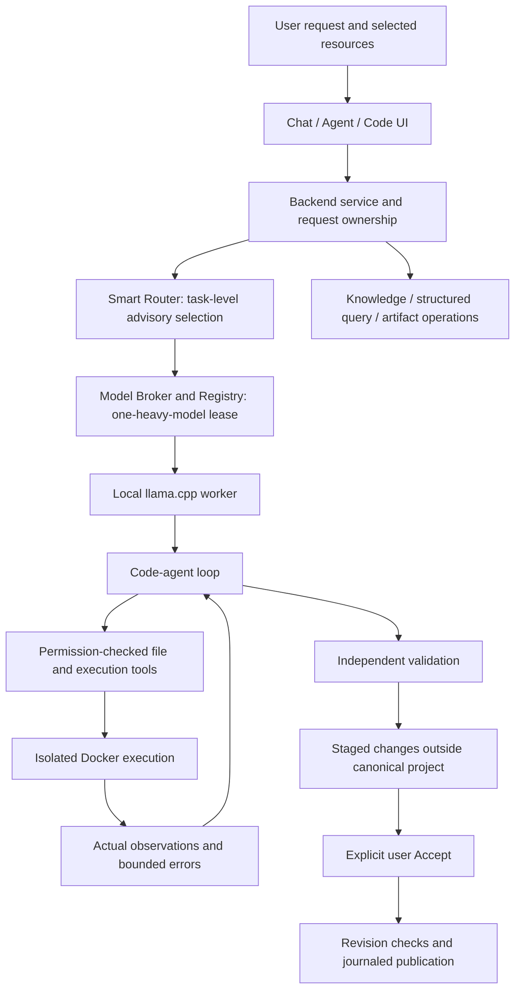

# SovereignAI — detailed project and status report

**Snapshot date: 7 October 2026.** Repository: `C:\Users\ashek\Desktop\SovereignAI`.

**Overall status: working engineering prototype; product completion and production acceptance remain incomplete.** Many local workflows and safety boundaries have been implemented and tested. Reliable completion of arbitrary application requests, broad browser acceptance, model selection quality, and all release gates have not been established. This document records implemented behavior, scoped observations, known limitations, and unfinished work separately.

This is a documentation snapshot, not a release approval. No production migration, model promotion, benchmark restart, or architecture change was performed to create it. Historical evidence is retained. A successful model response, generated files, HTTP 200, or passing model-written tests alone is not accepted as proof that the user’s request was fulfilled.

Follow-up on the same date: [proposed fixes evidence review](PROPOSED-FIXES-EVIDENCE-REVIEW-2026-10-07.md) records the saved T10 diagnosis and passive evaluator liveness instrumentation. T10 already made seven tool calls before its output-limit failure; disabled thinking and required tools were already requested. The experiment was not resumed by that follow-up.

Later continuation: [exact T10 replay](T10-EXACT-REPLAY-2026-10-07.md) completed both transports, reproducing identical prose with no raw tool calls. Docker re-verification passed 18/18. The four-model baseline was subsequently resumed; the earlier zero-completed/stale checkpoint described below is historical to this document's initial snapshot. Read live heartbeat and terminal result records for current coverage.

## Contents

1. Product purpose and environment
2. Architecture and module responsibilities
3. Product capabilities and limitations
4. Code-agent execution and publication
5. Routing, models, resources, and budgets
6. Security and sandbox boundaries
7. Verification history and current experiments
8. Known failures and remaining gates
9. Storage, operation, and evidence index
10. Completion assessment

## 1. Product purpose and environment

SovereignAI is a local Windows AI workbench combining **Smart LLM Routing + Local Code Assist + Secure Sandbox**, alongside Chat and document/structured-data assistance. The intended experience is that a user describes a task, the selected local model inspects the available resources, performs supported actions, observes actual execution results, repairs demonstrated errors within a budget, and provides a grounded answer or a validated staged change.

The model is expected to create requested applications. Backend code supplies execution tools, permissions, validation, and publication boundaries; it should not substitute a hard-coded application for the model’s work or inject prompt-specific solutions.

| Component | Current implementation/context |
|---|---|
| Host | Windows 11 laptop; approximately 16 GB RAM and RTX 3050 with approximately 4 GB VRAM |
| Backend | Python 3.12, FastAPI/uvicorn; local environment `.app-venv` |
| Frontend | Svelte application in `frontend/llama-ui`; Monaco editor integration |
| Workbench API/UI | `http://127.0.0.1:8088` |
| Model API | Local llama.cpp server on `http://127.0.0.1:8087` |
| Model runtime | llama.cpp b11132, CUDA runtime; installed quantized GGUF models |
| Retrieval | Local BGE-small-en-v1.5 CPU embeddings and SQLite-backed indexes |
| Generated-code execution | Docker only; no host execution fallback |
| Main surfaces | Chat, Agent, Code/IDE, Knowledge, Control Center |

Runtime endpoints above are configured addresses, not a claim that every service is currently online. The newest experiment process check found **no running `fidelity_v1.evaluate` Python process**.

## 2. Architecture and module responsibilities



The default production workflow and opt-in native code kernel coexist. Experimental adaptations reuse the existing native implementation; they do not introduce permanent supervisors, model registries, or controllers.

| Source/module | Responsibility |
|---|---|
| `backend/app.py` | HTTP API, upload and job entry points |
| `backend/service.py` | Workbench integration, request routing, Knowledge and coding coordination |
| `backend/model.py` | Local model API adapter, tool responses, context fitting, cancellation |
| `backend/settings.py` | Paths, ingestion bounds, default context and supervisor budgets |
| `backend/task_supervisor.py` | Shared request ownership, budgets, cancellation and safety/publication boundaries |
| `backend/task_skills.py` | Selection of trusted application-owned task instructions |
| `router/coding_router.py` | Cheap task/complexity/capability classification; advisory, not mutation authority |
| `router/model_broker.py` | Candidate admission, role constraints, runtime selection and residency decisions |
| `router/model_registry.py` | Model specifications, process identity, startup and single-server ownership |
| `router/code_agent.py` | Legacy bounded macro-action execution and continuation |
| `router/tool_registry.py` | Macro tool/action contracts and validation |
| `router/sandbox.py` | Docker execution, isolation policy and attestation |
| `workflows/agent_kernel.py` | Opt-in native model/tool loop, immutable request/workspace binding, observations and budgets |
| `workflows/coding_workspace.py` | Staging, explicit Accept/Discard, revision checks and publication |
| `workflows/build_contract.py` | Requested build/behavior contract support |
| `workflows/agent_runtime_validation.py` | Runtime validation support |
| `workflows/agent_capabilities.py` | Native capability adapters; some end-to-end publication coverage remains incomplete |
| `rag/ingest.py`, `rag/tables.py` | Document ingestion and bounded source-table operations/previews |
| `skills/runtime/` | Trusted runtime instructions, including task and code-tool guidance |
| `experiments/fidelity_v1/` | Isolated current evaluation harness; not production orchestration |

The macro registry and native micro-tool schemas are distinct layers. They should not be described as one physical registry class. A legacy routing adapter still exists on identified paths. Full routing consolidation and optimal selection are not proven.

## 3. Product capabilities and limitations

| Area | Implemented behavior | Verification boundary / limitation |
|---|---|---|
| Chat | Local generation, selected Knowledge scope, source-aware responses | Arbitrary semantic correctness is not guaranteed |
| Knowledge library | Upload, retained originals, indexing status, preview, rename/move/copy/delete metadata | Accepted upload does not mean indexing finished; deleting index records does not delete originals |
| Retrieval | Bounded passage retrieval and citations | Top retrieved passages are not complete-table evidence |
| Structured data | Validated table plans for lookup/count/sum/average/min/max over parsed records | Table/column selection can still be semantically wrong; constrained computation does not prove intent understanding |
| Spreadsheet preview | Sheets, stored cells, formats, merges, row virtualization, cross-sheet Find | No full Excel recalculation, chart fidelity, or conditional-format recalculation |
| Artifacts | Deterministic Word/Excel creation, reopening checks and downloads | Native artifact publication is not fully release-validated |
| IDE | Editing, project explorer, multi-file context, staged changes, Accept/Discard, terminal and Run | Not a full VS Code replacement; no embedded extension ecosystem, debugger adapters or persistent PTY guarantee |
| Cross-file code | Relevant module context, nested Python/Java/TypeScript/Go execution fixes | Supported tested examples do not prove arbitrary project comprehension |
| HTML/CSS preview | Source-relative asset handling and sandboxed preview paths | Browser/runtime behavior needs actual acceptance testing |
| Flask preview | Docker-backed HTTP adapter and separate preview state | Not a production server; WebSockets, streaming and external databases are outside the adapter |
| Agent repair | Exact error observations, bounded continuation, targeted patches | Unseeded complex tasks and repair preservation remain unreliable |
| Publication | Staging, Docker gate, revision recheck, journaled Accept and undo | External Windows writer race and simultaneous multi-file visibility limitations remain |
| Routing | Capability/task-level worker selection, one-heavy-model ownership | A model switch is not evidence of improved task quality |

### Knowledge ingestion and answers

Original receipt, extraction/indexing, preview and answering are separate operations. Imports retain source snapshots and document metadata before background extraction. Cancellation retains originals and avoids publishing an incomplete index. Imports have a separate bounded job lane from generation; this does not promise simultaneous GPU-heavy model execution.

Supported documented ingestion includes text/source files, PDF, DOCX, XLSX and PPTX, with structured imports including CSV/TSV, JSON/JSONL, YAML, XML, TOML and INI/CFG. Legacy XLS and arbitrary proprietary formats require conversion. OCR depends on the configured local runtime. Parsing occurs in the backend and is bounded, but is not itself an isolated parser-container guarantee.

The structured executor accepts constrained plans rather than model-generated Python or SQL. Aggregations expose matching/scanned/numeric record counts. Select results are capped and disclose truncation. The application may present independently computed records when generated prose fails validation; that fallback is valid computation presentation, **not successful natural-language generation**.

Reported assessment issues include threshold inheritance, ambiguous identity columns, incorrectly interpreting a single-cohort count as a comparison, incomplete requested student coverage, and omission of a comparative conclusion. The general solution requires request-bound interpretation, full relevant data coverage, explicit missing-record reporting and verified computation. A skill file alone does not establish that all these failures are resolved.

### Task skills

Trusted runtime skill instructions can guide resource inspection, task interpretation, calculations, file creation and validation. They must remain subordinate to the actual user request and tool permissions. Source documents are data, not privileged instructions. Skills cannot manufacture missing data, guarantee universal understanding, replace independent oracles, or authorize publication.

## 4. Code-agent execution and publication

The native kernel binds the original request, workspace identity/revision and chosen model to the task. It supplies structured actions, project context, bounded observations and shared budgets. Tool-call fragments are reconstructed by the model adapter. The worker must inspect relevant files before modifying them and use actual execution errors during repair.

1. Capture the request and workspace snapshot.
2. Select/acquire the worker through existing routing/broker infrastructure.
3. Let the model inspect files and choose permission-checked actions.
4. Write or patch the isolated candidate overlay.
5. Execute/check the candidate in Docker.
6. Return bounded real stdout/stderr/errors to the model.
7. Permit targeted repair within task budgets.
8. Validate against independent requirements/oracles.
9. Stage validated changes outside canonical project files.
10. Publish only after explicit user Accept and fresh revision/path/hash checks.

Model-written tests are supplemental. Supplied immutable tests and independently authored behavior checks provide stronger evidence. No-oracle HTTP/runtime probes establish only their tested properties; they do not prove an arbitrary request was fully met.

Workspace safeguards reject stale identity/revision, traversal and sensitive paths; preserve supplied tests/binary assets; constrain deletion to authorized scope; and require original inspection before edits. Repair patches require exact matching spans. Large patches can still exceed model output capacity.

Checkpoint storage primarily retains metadata, diffs and observations rather than copying the whole workspace after each action. Publication stores backups and durable journal state. Recovery preserves unexpected external changes and can quarantine only an affected workspace. Cooperating locks and repeated checks do not eliminate every uncooperative Windows filesystem race.

## 5. Routing, models, resources, and budgets

### Installed comparison candidates

| Model | Local artifact | Role/status |
|---|---|---|
| Qwen3.5-4B | `models/Qwen3.5-4B-Q4_K_M.gguf` | Existing text worker; fixed worker in completed runner comparison |
| Qwen2.5-Coder-3B | `models/qwen2.5-coder-3b-instruct-q4_k_m.gguf` | Existing coding baseline; native tool-use reliability still under investigation |
| Granite-4.2-3B | `models/Granite-4.2-3B/granite-4.2-3b-Q4_K_M.gguf` | Installed/hash-verified experimental candidate; no completed current comparison arm |
| mini-coder-1.7B | `models/mini-coder-1.7B/mini-coder-1.7b-iq4_nl-imat.gguf` | Installed/hash-verified experimental candidate; no completed current comparison arm |

Existing vision capability is also part of the workbench registry, but is not one of the four current code-worker comparison arms. Compatibility with llama.cpp does not prove structured action fidelity or coding success. Qwen2.5-Coder’s recorded source license is `qwen-research`; Qwen3.5 and Granite are recorded as Apache-2.0; mini-coder quantization metadata records MIT. Consult source metadata/notices before distribution.

The mini-coder artifact uses IQ4_NL while the other listed candidates use Q4_K_M. This comparison is between practical local artifacts and has a quantization confound. No model winner has been established by the current four-model experiment.

One heavy model is permitted at a time. Runtime identity, startup readiness and lease ownership matter: a UI label is not authoritative proof of which process served a request. Unknown resource metrics remain null. Historical peak-profile and admission gaps must not be hidden by successful loading.

### Configuration and bounds

| Scope | Recorded configuration |
|---|---|
| General settings | Context default 24,576; output 4,096; actual model limits may be lower |
| Current fidelity comparison | Context 16,384; output 4,096; temperature 0; fixed runtime/profile |
| Native comparison loop | 32 turns, 64 tools, 12 Docker executions, 600 seconds |
| Comparison owning supervisor | 660 seconds; 32 model calls; 64 tools |
| Native service task | 840 seconds inside a 900-second owner budget |
| General supervisor defaults | 64 model calls; 12 tools, or 64 with native opt-in; 4 switches; 900 seconds |
| Native production flag | `SOVEREIGN_AGENT_KERNEL`; default `0`, opt-in remains unpromoted |
| Ingestion | 20 MiB/file; 200 pages; 20,000 chunks; chunk size 384 and overlap 48 |

Evaluation switch allowance exists because the shared constructor rejects zero, but no escalation is provided in the fixed-worker stage and actual switches are zero. Evaluation timing is not a reproduction of the longer UI timeout profile.

## 6. Security and sandbox boundaries

The trusted backend owns authorization, validation and publication. Generated code is untrusted and runs in disposable Docker copies, without host execution fallback or unrestricted online package installation.

Recorded policy includes non-root UID/GID 65534, no network, read-only root/input, all capabilities dropped, no-new-privileges, 64 PID limit, approximately 512 MiB memory/no extra swap, one CPU, execution timeout at most 120 seconds, bounded output volumes/files and 65,536-byte output capture. The verifier binds evidence to image/policy/source and freshness. These settings should be checked against current source/attestation when running a new task.

Installed dependencies are inspected; offline installation constraints are explicit. Missing Flask caused a demonstrated historical app failure. A later pinned image included Flask 3.1.2 and Flask-SQLAlchemy 3.1.1. Arbitrary missing dependencies remain a legitimate BLOCKED condition, not automatically a model failure.

Eighteen passing isolation probes establish the tested behavior, not immunity to Docker/kernel vulnerabilities, every covert channel, or every credential path. Publication is not simultaneous atomic visibility of all project files, and unconditional device/power-loss durability has not been established.

## 7. Verification history and current experiments

### Historical milestones — scoped evidence

| Evidence checkpoint | Result | Interpretation |
|---|---|---|
| September release assessment | 648 backend tests, 7 skipped; 93 routing workflow executions | Historical source checkpoint; CPU classifier promotion and broad acceptance remained incomplete |
| October 4 IDE audit | Docker Python/Java/TypeScript/Go/C examples returned independently expected 42; targeted preview browser checks passed | Demonstrated cross-file/runtime fixes; not universal IDE correctness |
| Agent-kernel rebuild | Six isolated workflows accepted after independent validation | Flask, Node, Java, Python edit, calculator and repair examples succeeded |
| Additional Qwen3.5 multi-file API edit | Accepted; about 64.7 seconds, 7 calls, 2 sandbox runs, zero switches | Specific successful native workflow |
| Qwen2.5-Coder mechanical rename | Failed before any tool; output limit reached | One native tool-use failure; API compatibility was insufficient |
| Kernel-rebuild regression | 1,310 passed, 7 skipped, 1 warning | Saved checkpoint evidence; not rerun for this document |
| Final affected subset | 71 passed, 1 warning | Overlaps other suites; do not add to regression total |
| Frontend check | Zero errors/warnings at recorded checkpoint | Build/type checks are not browser acceptance |
| Docker verifier | 18/18 at recorded checkpoint | Policy-scoped historical verification, not a newly refreshed attestation |

The unseeded attendance UI request still had no accepted completion in the rebuild evidence. Long repair chains, interface/identity assumptions, invalid JSON behavior and budget exhaustion remained. An attempt passing its own tests before timeout did not establish independent validated completion.

### Current isolated Code-Agent Fidelity experiment

Evidence root: `evidence/code-agent-fidelity-v1/`. Frozen source hashes and an isolated native snapshot are preserved. The new 15-task suite does not modify historical held-out tasks or outcomes.

Three arms reuse the same native core, tools, context, model, Docker and evaluator:

- **Native v1:** baseline semantics with observation instrumentation.
- **Nanobot minimal:** checkpoint adaptation and independent property-regression rollback.
- **Hermes minimal:** the same preservation safeguards plus bounded action-format recovery.

These are narrow adaptations, not full framework installations or benchmarks of complete Nanobot/Hermes products. Upstream source was saved as inert text, not installed as an execution framework.

Research pins: Nanobot `42f06ab1dcf7329f6bdcce9256fea74a99d19cbb`; Hermes `17d4518c5043ff3a94e01ea544fac7b6d87b3645`; mini-SWE `04d809ceab9df28f9adaed044884180159172930`. Manifests retain source URLs, hashes and dates. Adopted ideas concern query/execute/observe loops, paired observations, bounded format recovery, checkpoints and repair preservation. Messaging, delegation, auxiliary model summaries and ecosystem expansion were excluded.

### Task coverage

| ID | Category |
|---|---|
| T01 | Single-file mechanical rename |
| T02 | Multi-file rename |
| T03 | Mean calculation bugfix and empty-input exception |
| T04 | Function addition with unrelated function preservation |
| T05 | Flask API modification and invalid/malformed input behavior |
| T06 | Multi-file event counts and reporting |
| T07 | Coordinated JavaScript payload, form and backend schema |
| T08 | Inventory identity consistency, invalid-operation atomicity and exceptions |
| T09 | Raised exception semantics rather than returned exception objects |
| T10 | Dependent reservation feature, capacity, atomicity, cancellation/reset |
| T11 | Stable unique ordering and falsey-value preservation |
| T12 | Cancellation after model response, before tools |
| T13 | External revision change and stale publication rejection |
| T14 | Explicit acceptance |
| T15 | Explicit rejection/nonpublication |

All 30 oracle controls passed: 15 reference-positive and 15 intentionally incorrect candidates. Six harness checks passed. Supplied tests are visible to the model; this small suite is not a broad unseen generalization study. T07 verifies module/form/backend contracts, not full interactive browser acceptance.

### Completed fixed-worker runner results

**45/45 terminal runner/task results exist.** All used Qwen3.5-4B. Coding and lifecycle results are separated.

| Runner | Coding PASS | Coding FAIL | Coding completion | Lifecycle PASS | Median latency, all 15 cases | Total model calls, all 15 |
|---|---:|---:|---:|---:|---:|---:|
| Native v1 | 10/11 | 1 | 90.91% | 4/4 | 36.407 s | 88 |
| Nanobot minimal | 10/11 | 1 | 90.91% | 4/4 | 36.609 s | 88 |
| Hermes minimal | 10/11 | 1 | 90.91% | 4/4 | 37.922 s | 90 |

The primary coding metric excludes lifecycle controls. Every arm failed **T10**. Native and Nanobot reached the output limit while returning discussion instead of the required tool action; Hermes exhausted its owning time budget. There was no observed coding-completion gain from either adaptation. Harness proof of rollback/recovery is not proof that those mechanisms improved live task completion.

Execution order was fixed, with warm caches retained. Median timing is descriptive and confounded; it does not prove causal speed superiority. The initial actual request hash matched across all three arms. Actual model switches were zero.

### Environment interruption and preservation

An external interruption stopped services and the controller. Fourteen valid terminal pairs were preserved. A resumed sweep produced 31 zero-call sandbox-unavailable outcomes because Docker’s pipe was missing. These were explicitly adjudicated as **BLOCKED / ENVIRONMENT**, preserving raw original records. Docker was restored and only affected pairs were rerun. Current terminal runner rows have no unresolved environment blocks.

This is not 31 model failures. Evidence includes the interruption report, original result snapshot, per-case adjudication and resumed logs. Harness changes were limited to environment preflight, stopping affected arms and preventing unresolved blocks from passing phase gates.

### Saved attendance diagnostic

Three earlier trajectories were reconstructed into **24 candidate stages**, with **zero new LLM calls**. Successful saved file actions were replayed and candidate behaviors independently probed in Docker. Symbol inventories, changed/removed functions, regressions and actual errors are preserved.

This is a diagnostic replay, not a successful fresh attendance application run. An early incomplete candidate missing a README/test is not necessarily a final failure. Deleted internal symbols are not automatically deleted required behavior. Missing old exact prompt/handoff wire context prevents confident attribution to routing or context. Persistence across restarts was not imposed where the original request did not explicitly require it.

### Four-model comparison — incomplete

Artifact hashes and primary model metadata are prepared. The planned fixed-native-scaffold comparison covers the same 15 tasks for Qwen3.5, Qwen2.5-Coder, Granite and mini-coder: **60 planned executions**.

At this documentation snapshot, `results.json` contains **45 runner records and zero model-phase terminal records**. `progress.json` says Qwen3.5/T01 `EXECUTING`, but no evaluator process was found. Treat this as an **interrupted/stale checkpoint**, not an active completed benchmark. The aggregate file’s `RUNNING` label likewise is not live process evidence.

**No four-model ranking or winner is available.** Controlled Coder output-limit diagnosis, current routing analysis, final experiment audit/report and migration decision remain pending. The old 40-task/four-arm comparison and historical six-arm studies are separate evidence; their incomplete snapshots must not be represented as this experiment’s results.

## 8. Known failures and remaining gates

| Issue | Observed evidence / status |
|---|---|
| Request drift | Calculator request previously produced unrelated search files; stale/inherited task interpretation is a demonstrated risk |
| Missing runnable entrypoint | Unseeded attendance request rejected before files changed; requires model/tool fidelity rather than a hard-coded app |
| Complex generation/action fidelity | T10 failed in all current runner arms; prose/output-limit behavior blocked actions |
| Coder native tool use | Recorded rename failed before tools despite API compatibility |
| Repair regressions | Earlier invoice function removal and returned KeyError semantics; targeted repair/preservation needs independent verification |
| Repeated-action stopping | Earlier todo Run stopped without successful application run; successful later targeted probes do not prove every continuation fixed |
| Dependency availability | Missing Flask historically blocked execution; offline dependency readiness remains task-specific |
| Preview behavior/performance | Connection refusal/fetch errors, request cold-start costs and incorrect output were reported; broad latency/interaction acceptance remains open |
| Job state and navigation | Stale busy/loading labels, workspace locks and chat interference were reported; current full cross-surface acceptance is not established |
| Structured answer completeness | Missing requested records/conclusion and incorrect threshold/cohort inheritance are semantic risks |
| Router promotion | Historical CPU-first quality/coverage gate failed; no current evidence justifies superiority claims |
| Resources | Complete representative RAM/VRAM/load/unload comparison is unfinished |
| Publication | Uncooperative Windows TOCTOU and atomic multi-file visibility limitations persist |
| Native artifacts | Full end-to-end publication acceptance remains incomplete |
| Broad release acceptance | Full fresh browser matrix and final complete experiment audit remain unfinished |

Failure attribution should distinguish router, context, plan/handoff, generation, repair, tool, sandbox, validation, resources, timeout and environment. No sophisticated router is being tested in the fixed-worker comparison, so a coding failure there is not automatically a routing failure. BLOCKED must remain distinct from FAIL.

## 9. Storage, operation, and evidence index

### Persistent locations

- Repository source: `C:\Users\ashek\Desktop\SovereignAI`.
- Default user projects: user Documents `SovereignAI/Projects`, overridable by `SOVEREIGN_PROJECT_DIR`.
- Default Knowledge source snapshots: user Documents `SovereignAI/Knowledge`, overridable by `SOVEREIGN_KNOWLEDGE_DIR`.
- Backend state/indexes: repository `data/`, overridable by `SOVEREIGN_DATA_DIR`.
- Models: `models/`; Python environment: `.app-venv`; frontend: `frontend/llama-ui`.
- Experiments and raw evidence: `experiments/`, `evidence/`, `outputs/`, `benchmarks/`.

Docker terminal paths describe container copies, not host paths. External editor refresh must preserve unsaved drafts. Existing user sources and historical failures must not be silently deleted during cleanup.

### Dated storage audit

The earlier kernel-rebuild storage audit measured approximately **29.66 GiB** in the repository. Models accounted for 20.334 GiB; Python environments 3.209; source/other 2.916; node_modules 1.192; runtime 1.087; test outputs/evidence approximately 0.735. Workspaces/staged changes were approximately 0.005 GiB. Thus models, not per-action workspace copies, dominated that measured snapshot.

This is not a fresh disk measurement; current raw evidence adds storage. Docker storage is separate. `_review_for_deletion` contained retained material, not deleted material. Only marked owned ephemeral caches are eligible for bounded retention cleanup; user projects, artifacts, models and historical evidence are not automatic cleanup targets.

### Operation and reproduction

Existing startup/stop launchers and PowerShell scripts manage the local workbench. Use repository setup instructions for environment/dependency preparation. Do not run a heavy evaluation concurrently with a live model-owned user job.

```powershell
# Read the current experiment checkpoint; this does not resume it.
Get-Content evidence/code-agent-fidelity-v1/progress.json
Get-Content evidence/code-agent-fidelity-v1/results.json

# Focused isolated harness tests; not a replacement for live model evaluation.
.app-venv/Scripts/python.exe -m pytest experiments/fidelity_v1/test_runners.py -q

# Explicit model-stage continuation command, only in an exclusive runtime window.
# Not executed for this documentation request.
.app-venv/Scripts/python.exe -m experiments.fidelity_v1.evaluate --phase models
```

Do not restart a completed valid task merely to improve its outcome. Preserve incomplete attempts, original failures and environment adjudications when resuming.

### Primary evidence and documentation

| File/directory relative to repository | Purpose |
|---|---|
| `README.md` | Setup and product entry points; historical model-name text may differ from current registry |
| `docs/knowledge-architecture.md` | Ingestion/query/grounding contracts and limitations |
| `docs/ide-audit.md` | October 4 cross-file, dependency and preview repairs |
| `docs/publication-architecture.md` | Journal, Accept, revision and recovery boundaries |
| `docs/sandbox-architecture.md`, `docs/sandbox-threat-model.md` | Isolation policy and threat-model boundaries |
| `docs/router-architecture.md`, `docs/router-evaluation.md` | Routing implementation and historical promotion evidence |
| `docs/final-release-report.md` | September release gate matrix; historical, not latest final approval |
| `outputs/agent-kernel-rebuild/report.md` | Kernel milestone successes, failed attendance attempts and regression evidence |
| `outputs/agent-kernel-rebuild/summary.json` | Machine-readable milestone summary |
| `outputs/product-completion-20261005/report.md` | Earlier scoped product checks |
| `evidence/code-agent-fidelity-v1/results.json` | Current terminal result projection; labels may be stale after interruption |
| `evidence/code-agent-fidelity-v1/summary.csv` | Current flattened comparison records |
| `evidence/code-agent-fidelity-v1/progress.json` | Saved checkpoint, not process liveness |
| `evidence/code-agent-fidelity-v1/reports/baseline-manifest.json` | Frozen source hashes |
| `evidence/code-agent-fidelity-v1/reports/tasks.json`, `tasks.sha256` | Frozen new suite and fingerprint |
| `evidence/code-agent-fidelity-v1/native/`, `nanobot/`, `hermes/` | Per-task rows, attempts, calls, Docker/oracle results and acceptance evidence |
| `evidence/code-agent-fidelity-v1/reports/upstream/` | Inert pinned upstream source and manifests |
| `evidence/code-agent-fidelity-v1/reports/ARCHITECTURE-COMPARISON.md` | Adaptation/mechanism comparison |
| `evidence/code-agent-fidelity-v1/reports/model-source-review.json` | Verified model artifact/specification metadata |
| `evidence/code-agent-fidelity-v1/attendance-diagnostic/summary.json` | Saved candidate-stage diagnostics |
| `evidence/code-agent-fidelity-v1/reports/INTERRUPTION-01.md` | External interruption evidence |
| `evidence/code-agent-fidelity-v1/reports/HARNESS-ENVIRONMENT-CORRECTION.md` | Explicit environment correction and rerun rationale |

## 10. Completion assessment

**Established facts:** the workbench and major infrastructure exist; scoped multi-language/app workflows can pass; explicit publication and sandbox checks have recorded passes; the latest fixed-worker comparison completed 45 terminal cases with equal coding results; environment-induced outcomes were preserved and corrected transparently.

**Supported interpretation:** the immediate bottleneck is not solved by adding more orchestration. Model action fidelity, request/context fidelity, bounded generation, targeted repair and independent behavior validation remain central. Minimal Nanobot/Hermes adaptations did not improve measured coding completion in this suite.

**Not established:** universal task understanding, a winning code model, overall new-kernel superiority over the old workflow, optimal routing, full browser correctness/performance, or production readiness.

The evidence-supported engineering sequence is to preserve the completed runner results, finish the interrupted fixed-kernel model comparison, diagnose output-limit/action failures under controlled conditions, complete the independent failure/oracle audit, and then assess narrowly justified changes. Production promotion requires fresh explicit acceptance evidence. A new planner, reviewer, mandatory Qwen-to-Coder handoff or larger architecture is not justified by the current comparison.

**Current completion label: INCOMPLETE.** The documentation deliverable is complete; the product and experiment have the outstanding gates listed above.
