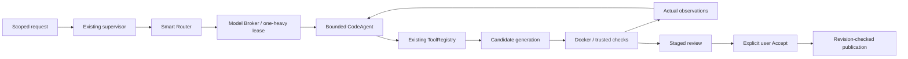

# Hybrid Phase B final-report scaffold

Evidence checkpoint: 2026-10-03, frozen production HEAD `73bb304`. This is an **interim scaffold**, not a completed comparison report. The final six-arm run is **RUNNING**: F completed 100 cases; E had 11 cases at this checkpoint; 600 paired arm/case executions are planned. Do not interpret partial ordered rows as final quality or performance results. No model calls, Docker runs, held-out reads or production edits were made to prepare this report.

Primary evidence: [implementation record](nanobot-hybrid-phase-b.md), [corrected live audit](hybrid-corrected-live-review-audit.md), [corrected live raw results](../benchmarks/hybrid-live-acceptance-corrected-20261003.json), [independent explanation review](../benchmarks/hybrid-live-corrected-semantic-review.json), [browser fixture evidence](../benchmarks/hybrid-browser-acceptance-corrected/results.json), [comparison methodology](../benchmarks/hybrid-code-agent/README.md), [running final comparison](../benchmarks/hybrid-code-agent-final-results.json), and [provisional F analysis](../benchmarks/hybrid-code-agent-final-analysis-progress.json). The analysis snapshot includes F100 but no E rows; E11 is the later raw-run progress checkpoint. Status labels describe only the specified evidence, never universal reliability.

## 1. Exact Nanobot components adopted.

**PASS — selective inspiration; no upstream package/source imported.** No Nanobot component was installed as a replacement subsystem. Architectural decisions are documented in [architecture comparison](nanobot-sovereign-architecture.md).

## 2. Exact components adapted.

**PASS — implemented.** Small explicit runner, immutable bounded task-context/state views, typed observations, exact registered-action identity, owned cancellation and common bounded repair policy. Validated operation-plan reuse skips planning only; it preserves generation, preflight and execution. See [design](nanobot-phase-b-design.md) and implementation record.

## 3. Components rejected.

**PASS — scope decision.** Upstream Windows shell execution, direct writes without acceptance, broad tool permission, concurrent heavy subagents and unrelated channels/cron/memory/connectors. Runtime/security reasoning is recorded in [runtime audit](nanobot-runtime-audit.md) and [security audit](nanobot-security-audit.md).

## 4. SovereignAI components preserved.

**PASS — architectural ownership.** Existing supervisor, Smart Router, Model Broker/leases/resource admission, ToolRegistry, Docker isolation, trusted validation provenance, staged artifacts, ledger, revision guards and explicit Accept remain authoritative. No second task database or residency owner was introduced.

## 5. Files changed.

**PASS — production inventory relative to Phase A `89fb7fe`.** `backend/model.py`, `backend/service.py`, `backend/task_supervisor.py`, `router/code_agent.py`, `router/code_agent_state.py`, `router/request_normalization.py`, and `workflows/coding_workspace.py`. Additional regression tests, audits, benchmark authoring/harness and acceptance evidence accompany these changes. The benchmark freezes hashes in its provenance; this inventory is not a claim that every earlier user issue was changed.

## 6. Final architecture diagram.

**PASS — implemented ownership boundaries.**

## 7. Router flow.

**PARTIAL — exercised, not optimal.** Selected workspace/request scope and bounded context inform existing admission and worker selection. Simple code can take Coder directly; complex work can plan with Qwen before Coder; explanation uses lightweight and images require vision eligibility. General normalization preserves original text. Corrected architecture still fails after handoff; final comparative routing effectiveness is **NOT VERIFIED**.

## 8. CodeAgent loop.

**PASS — bounded mechanism; PARTIAL — live outcomes.** Delegate admitted exact action, ingest concrete observations, retain shared supervisor authority, repair within budget, stop on missing execution/feedback, repeated concrete failure or exhaustion. Project candidate attempts are bounded at three; source-shape/semantic retries are separately counted. The runner cannot select arbitrary tools or publish. A valid plan is not proof of correct code.

## 9. Model Broker behavior.

**PASS — ownership retained.** Broker owns eligibility, warm affinity, switching cost, residency and leases. Runner does not create another broker or switch workers during repair. Existing single-heavy policy remains. Benefit versus alternatives awaits the paired comparison.

## 10. Model residency observations.

**PARTIAL — sampled evidence.** Corrected live traces observed at most one llama-server process at sampling points, including rename and architecture. This supports sampled compliance, not continuous proof between samples. Null resource metrics must remain unknown.

## 11. Model-switch results.

**PARTIAL.** Corrected warm Coder edit: zero switches and PASS. Architecture: two switches, thirteen calls, FAIL; Qwen→Coder handoff occurred but successful complex completion is **NOT VERIFIED**. These observations do not establish a causal switching benefit.

## 12. Code-assist results.

**PARTIAL.** Corrected rename and batch-function fix passed independent trusted Docker checks; warm Coder edit passed. Explanation passed independent answer-hash/source review while backend transport remains UNKNOWN. Scoped follow-up checks passed but were syntax-only. Architecture is **FAIL**; rejected generated source was not retained, leaving actual defect versus reviewer false positive **UNKNOWN**.

## 13. Sandbox results.

**PASS — verifier 18/18; live execution on successful edit cases.** Existing restricted mounts, network disabled, non-root, read-only root, dropped capabilities, no-new-privileges and CPU/memory/PID constraints remain. No host fallback was introduced. Browser fixture acceptance performed no Docker execution and cannot substitute for this evidence.

## 14. Automatic repair results.

**FAIL — observed F recovery outcome.** Five repairs were observed in the completed F development arm; zero independently verified recoveries. This is not evidence that additional retries would solve failures.

**NOT VERIFIED — successful generated-failure recovery.** The corrected case named `generated_repair` passed its first generated candidate; its name is not evidence of automatic recovery. Preserved development pilot includes a failed candidate repeated unchanged and a stop. Unit mechanism checks support bounded replay/termination, not live recovery success.

## 15. Completion behavior.

**PARTIAL.** Transport completion, semantic review and actual validation remain distinct. Zero exit/execution evidence is required for the runner's validated stop; trusted-test provenance identifies what was checked. Explanation transport UNKNOWN and failed architecture are not promoted to success. Syntax-only checks do not prove requested behavior.

## 16. Publication safety results.

**PASS — tested disposable paths; PARTIAL — cancellation coverage.** Stale Accept returned HTTP409; separate explicit Accept published exact candidate bytes. Pre-generation cancellation preserved source with zero model calls. Active-stream cancellation is **NOT VERIFIED**. Browser staged-review checks confirmed no automatic publication; production user workspaces were not used.

## 17. Benchmark results.

**PARTIAL — F development arm complete.** Provisional analysis reports 73 PASS, 2 PARTIAL, 25 FAIL across F100. This replaces the earlier 68-row F checkpoint; it establishes neither six-arm superiority nor universal correctness. The six-arm comparison remains running and E is partial.

**NOT VERIFIED — final comparison incomplete.** Six arms ×100 development cases; final raw state RUNNING with F100 complete and E11 partial at this checkpoint. A–E retain exact frozen service orchestration, all six use identical current coding tools/sandbox/validation, F uses hybrid orchestration/cache. This is not historical full-binary equivalence. Offline authoring: 85 good references pass, 85 unfinished baselines fail; 15 explanation cases need independent semantic review. The 25 declared clusters are correlated, including one visual family. Earlier 71-case F-only pilot: 52 PASS, 2 PARTIAL, 17 FAIL; it is preserved separately and not a six-arm result. Historical held-out hashes remain preserved according to the implementation record; no contents were used here.

## 18. Latency.

**PARTIAL — F development arm complete, six-arm comparison running.** F latency p50 24.01519 seconds and p95 110.14421 seconds; no comparative speedup is established. Corrected live observations remain below. Wall latency includes admission; no paired speedup is established. The following table also supplies the raw evidence for sections 19–22. Full-run metrics remain provisional until completion and independent analysis.

| Corrected live case | Seconds | Model calls | Switches | Peak sampled RAM MiB | Peak sampled VRAM MiB |
|---|---:|---:|---:|---:|---:|
| Explanation | 25.04 | 1 | 1 | 2303.53 | 2618 |
| Rename | 47.70 | 6 | 1 | 2460.07 | 3297 |
| First-candidate batch fix | 20.37 | 3 | 0 | 2456.97 | 3063 |
| Architecture (FAIL) | 85.56 | 13 | 2 | 3495.69 | 3400 |
| Warm Coder | 24.72 | 3 | 0 | 2511.88 | 3196 |
| Pre-generation cancellation | 3.84 | 0 | 0 | 2502.84 | 3116 |

## 19. Calls.

**PARTIAL.** Completed F development arm: 511 model calls. Corrected live counts are above. They include planning, generation and model review. Controlled reuse checks establish that a planning call can be skipped; end-to-end call reduction and quality tradeoffs are **NOT VERIFIED** without the completed paired run.

## 20. Switches.

**PARTIAL.** Completed F development arm: 52 switches. Corrected live counts are above. Zero-switch warm success and two-switch architecture failure must both be retained. Final switch distribution and success-conditioned analysis are pending; no claim of optimal routing.

## 21. RAM.

**PARTIAL — sampled peaks.** Completed F development arm maximum sampled RAM: 4241.46484 MiB. Table reports corrected-live `peak_ram_mib`; these are telemetry measurements, not continuous machine-wide accounting or a guarantee for every task. Final paired memory analysis is pending.

## 22. VRAM.

**PARTIAL — sampled peaks.** Completed F development arm maximum sampled VRAM: 3506 MiB. Table reports corrected-live `peak_vram_mib`. Sampling can miss transient maxima; the complete comparison and missing-data audit remain pending. No promise that all future tasks fit the laptop is justified.

## 23. Test results.

**PASS — current recorded gates.** Backend 1,143 passed /7 skipped; frontend 728 passed; Svelte zero errors/warnings; production build passed; Docker verifier 18/18; corrected built-browser/API fixture three checks passed with zero inference/Docker calls. Browser status503/service-worker warnings are retained and prevent live-generation/PWA claims. Corrected live run finished eight checks with differing evidence/status as described above; finishing checks does not mean all eight task outcomes passed.

## 24. Limitations.

**PARTIAL / UNKNOWN.** Model weights were not trained/replaced. Same-worker semantic review is not independent verification. Architecture source rejection cannot be independently adjudicated without retained candidates. Visual structural checks do not establish rendering fidelity. Follow-ups are bounded/scoped and partly syntax-only. Successful automatic repair, active-stream cancellation, comparative quality/latency/resource gains and continuous residency compliance remain unproven. No universal correctness or optimality claim is supportable.

## 25. Remaining blockers.

**NOT VERIFIED — final superiority/adoption judgment awaits evidence.** Complete the frozen 600-execution comparison, perform answer-bound independent semantic review and clustered paired analysis, audit missing telemetry/failure layers, and report final metrics. Preserve architecture failure and automatic-repair gap; a future source-evidence investigation requires its own narrow scope. No new external blocker was established by this read-only review. Do not expand architecture, tune on held-out data, or modify frozen production during this run.

