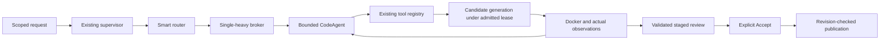

# Nanobot-inspired CodeAgent migration

Implementation checkpoint: project-scope compatibility correction after `1e3dea9`. Initial live acceptance is complete; comparative evaluation remains unfinished. **No claim of better model accuracy, optimal routing or universally correct task execution is established.** Historical comparison remains partial and archived.

## 1–4. Component decisions

No Nanobot package or source code was imported. **ADAPTED:** bounded runner boundary, immutable admission/context views, exact registered action identity, real observation replay and owned cancellation. **INSPIRE ONLY:** provider/session/subagent concepts. **REJECTED:** upstream Windows shell backend, direct unaccepted writes, broad permissions, concurrent heavy children, unrelated channels/cron/memory/connectors. Preserved SovereignAI router, broker, leases, resource admission, Docker, staged artifacts, trusted-test provenance, revision/cancellation guards and explicit Accept transaction.

## 5. Files and incremental checkpoints

`router/code_agent_state.py` exposes immutable bounded context, typed observations and a read-only view of existing supervisor state. `backend/task_supervisor.py` exports this projection without a second store. `router/code_agent.py` delegates admitted actions through the existing `ToolRegistry` and supplies the common repair decision policy. `backend/service.py` connects its already-selected worker to the runner. `workflows/coding_workspace.py` revalidates reusable operation plans and uses the shared repair policy on the legacy entry path. Existing publication and sandbox implementation were not rewritten.

Checkpoints: `06a6915` state view; `04e5c84` runner/policy; `db717b4` integration/reuse; `846b4eb` asset error compatibility. Each increment received targeted regression checks. Benchmark/acceptance code is separate from production. The new development set is frozen with 100 cases; byte hashes and correlated contract limitations are documented in its README.

## 6–8. Architecture, routing and loop

The coding adapter admits one exact candidate tool; it does not expose an unrestricted model-selected shell. That backend callback owns generation and existing Docker validation. The runner owns delegation, observation ingestion, iteration and stop conditions. The existing supervisor alone owns global budgets and terminal state. Router/broker selection occurs before the loop; the runner cannot change workers or publish.

## 9–11. Broker, residency and switching

Existing four workers and eligibility/resource policies remain. Straightforward code uses Coder; a complex task can persist Qwen planning before Coder admission; Vision requires image input. Warm affinity and switch-cost evidence remain broker responsibilities. Repair does not acquire a different lease. Live switch outcomes, timing, RAM/VRAM and sampled server counts are recorded separately; an observed successful task is not a causal switch-benefit experiment. Unsupported switch-effect claims remain **UNKNOWN**.

## 12–14. Code assist, sandbox and repair

The project loop permits three candidate attempts, stops unavailable execution, missing feedback, repeated concrete failure or exhausted attempts, and replays bounded untrusted candidate/diagnostic data against the original request. Reusable plans bind workspace, target, exact request, original files/folders and plan hash. Reuse skips operation planning only; complete preflight, fresh generation and actual Docker execution remain. A stale revision stops. Structural plan validity is not semantic correctness.

Docker's actual isolation verifier passed **18/18** at this checkpoint. Network disabled, non-root, restricted mounts, read-only root, capability removal, no-new-privileges and CPU/memory/PID limits remain authoritative. No host execution fallback was introduced. Live generated-failure-to-repair success remains **NOT VERIFIED** until its exact trajectory proves a changed candidate and independent pass. A broken initial file or simulated validator is not that proof.

## 15–16. Completion and publication

Runner transport completion is separate from semantic success. Its `validated` stop requires execution and zero exit; backend trusted/syntax/format provenance still distinguishes what was checked. Staged results remain awaiting explicit acceptance. Cancellation and changed revisions block publication; the model, router and runner have no publication method. Existing ledger/artifact records remain authoritative.

## 17–22. Benchmark and performance

Six arms: pinned Gemma/Qwen/Coder, previous broker, frozen V2 coding methods, hybrid. They share runtime settings, tools, independent oracles and Docker. E is an exact frozen coding-entrypoint adapter in the common current runtime, **not a historical full-binary deployment**. A–E bypass the new coding runner; F uses it. History updates are disabled to avoid ordered oracle leakage.

The new 100-case development set comprises 25 declared correlated clusters; five visual layouts share a family. Offline authoring: **85 references passed and 85 broken baselines failed**; 15 explanations require answer-hash-bound semantic review. Visual structure/style tests do not establish rendered fidelity. Existing held-out files match preserved hashes; no tuning from their results.

Completed six-arm results, paired independently validated quality, latency/calls/switches/RAM/VRAM and causal switch effects are currently **NOT VERIFIED / UNKNOWN**. Raw live evidence must remain immutable, with model, environment, tool, validation and publication failures distinguished. Reduced planner calls in controlled regression tests are a mechanism check, not measured live superiority.

## 23. Verification

Full backend rerun: **1,091 passed, seven skipped**. Frontend: **728 passed**, Svelte **zero errors / zero warnings**, production build **passed**. Docker verifier: **18/18 passed**. A previous full backend run found one changed protected-asset error message; compatibility was restored and the full suite rerun. Tests were not weakened. Browser acceptance and live model/Docker acceptance are tracked independently and are not substituted by unit simulations.

## 24–25. Limits and remaining work

Installed model weights were not trained or replaced. The same worker's semantic review can still reject plans or add calls; it is not independent verification. Context source limits and legacy persistence are retained instead of a broad rewrite. A structurally valid but faulty plan may repeat until the existing stop policy terminates; no unlimited regeneration or automatic replan was added. Accuracy and latency gains require the complete comparison. Remaining work is live acceptance, browser evidence, complete paired benchmarks and truthful final adoption decisions. Architectural expansion stops here.

### Initial live acceptance evidence

`benchmarks/hybrid-live-acceptance-20261003.json` preserves the original run. Explanation: Gemma, one model call, 19.35 seconds including admission, sampled one server; independent source comparison accepts the answer in `hybrid-live-semantic-review.json`. Backend transport remains UNVERIFIED rather than treating a model's reply as proof. Rename: FAIL before execution, seven calls, semantic-review rejection. Batch-function fix: independent PASS, three calls, 24.72 seconds, first generated candidate passed; automatic generated retry recovery NOT VERIFIED. Architecture: FAIL before execution, eight calls, 72.51 seconds; Qwen→Coder switching occurred, but task success did not. Warm Coder edit: independent PASS, three calls, 28.14 seconds, same PID/no switch. Scoped follow-ups, cancellation, stale Accept rejection and separate explicit exact-byte Accept: PASS on disposable workspaces. All five sampled main tasks observed at most one heavy server; this is sampled evidence, not an assertion about every instant.

Rename and architecture reviewers incorrectly demanded implementation details in an intermediate operation plan; that is recorded as model/planning failure, not suppressed or counted as validation success. Subsequent source inspection also found that the new plan cache omitted the existing `project` scope; its compatibility correction and regression are tracked separately, without overwriting the initial live result.

Browser/API fixture acceptance passed three checks on the actual permitted port 8088 with zero model/Docker calls; screenshots and limitations are preserved under benchmarks/hybrid-browser-acceptance. The independent initial-live audit is docs/hybrid-initial-live-audit.md. Final backend regression after project-scope correction: 1092 passed, 7 skipped, one existing deprecation warning, 207.42 seconds.
