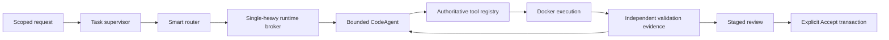

# SovereignAI / Nanobot architecture comparison — Phase A

Status: source audit complete; hybrid implementation and comparative performance **NOT VERIFIED**. This report precedes production refactoring. It is not a claim that any architecture or installed model is universally correct.

## 1. Upstream summary

Nanobot separates channel/session orchestration, a provider/tool runner, context assembly, tool contracts and subagent lifecycle. Its current source includes substantial delivery, persistence and recovery machinery; importing the whole framework would expand this desktop application's responsibilities.

## 2. Exact sources

Audited main: `432421bceba6e50ec435924c7b21ef341ed69e55`, inspected 2026-10-03. Latest release metadata inspected: v0.3.5, published 2026-09-15. Main and release are different evidence boundaries. [Pinned source](https://github.com/HKUDS/nanobot/tree/432421bceba6e50ec435924c7b21ef341ed69e55), [release](https://github.com/HKUDS/nanobot/releases/tag/v0.3.5). README and requested architecture, concepts and configuration documents exist. Upstream code was not installed or executed. Detailed pinned source references, selected tests and recent changes are in [runtime audit](nanobot-runtime-audit.md) and [security audit](nanobot-security-audit.md).

## 3. Current SovereignAI architecture

Production baseline is `89fb7fe9b4f654438d0efcb41c78329b1ab3c29d`. Public service dispatch, task supervision, worker broker/admission, tool registry, coding workflows, Docker execution, staged artifacts and explicit publication already exist. [Existing-source audit](sovereign-phase-a-audit.md) records exact ownership and call paths. The running V2 benchmark freezes this baseline; production, harness, settings and HEAD must remain unchanged until its comparison is preserved.

## 4. Three-way comparison

| Area | Current SovereignAI | Nanobot source | Proposed hybrid / decision |
|---|---|---|---|
| Request | Service dispatch and scoped follow-up | Channel/session admission | Keep API; adapt one task envelope |
| State | Supervisor, legacy step state, artifact ledger | Session plus runtime checkpoints | Adapt common observation view; preserve artifact transactions |
| Context | Several bounded task builders | Dedicated context builder | Adapt shared metadata and task-specific limits |
| Routing | Coding classifier and eligible-worker broker | Presets/provider selection | Keep smart router |
| Switching | Actual unload/load and resource admission | Immutable runtime selection | Keep hardware broker; adapt immutable admission |
| Affinity | Scoped worker preference | Session preset | Keep scoped affinity; no scope inheritance across chats |
| Tool loop | Multiple existing workflow entry paths | Bounded AgentRunner | Adapt small explicit loop behind current APIs |
| Registry | Validated application operations | Exact names, cached schema, argument normalization | Adapt only measured contract gaps |
| Planning | Strategy plus executable operations | Model/tool iteration | Reuse validated operations where applicable |
| Subagents | Software supervision and sequential roles | Background children, semaphore default four | Inspire only; serialize under global lease |
| Observations | Executor results and trajectories | Actual tool messages/checkpoints | Adapt typed events, preserve execution evidence |
| Repair | Separate project and single-file loops | Subsequent model/tool iterations | Adapt one policy, real diagnostics, bounded attempts |
| Completion | Observed executor contract | Runner final reply/error stop | Keep independent completion gates |
| Workspace | Selected ID, containment, revisions | Per-turn cwd/path scope | Keep authority; adapt scoped context pattern |
| Editing | Draft staging | Direct filesystem writes | Keep staged edits; do not import direct writes |
| Sandbox | Restricted Linux Docker | Windows unsandboxed fallback | Keep Docker; do not import backend |
| Resources | Single-heavy admission and sampling | Provider/subagent concurrency | Keep global resource owner |
| Streaming | Existing progress/output paths | Provider delta hooks | Adapt public output events; exclude private reasoning |
| Persistence | Task/artifact/publication records | JSONL sessions/checkpoints | Keep schema; adapter before migration |
| Safety | Backend policy and fail-closed execution | Tool guards and optional wrappers | Keep enforcement; policy denial is terminal |
| Publication | Explicit Accept transaction | Writes during execution | Keep explicit Accept |
| Extensibility | Local tools and worker roles | Broad connectors/channels | Adapt narrow interfaces only |
| Complexity | Repeated planning and overlapping views | Large recovery/delivery surface | Remove demonstrated duplication incrementally |
| Latency | Measured live calls/load/repair | No laptop comparison measured | Benchmark; no assumed benefit |

## 5. Current problems

Project repairs can repeat operation planning and generation of every planned file. Source-shape retries and semantic reviews add calls beyond the displayed repair count. State views overlap, but the two coding repair paths are separate—not a nine-attempt nested loop. Retrieval relevance does not establish full-table coverage. More model self-review does not prove correctness.

## 6. Useful upstream ideas

**ADAPT:** immutable task admission, bounded runner boundary, actual tool feedback replay, exact tool identity, typed progress/checkpoint events, owned cancellation, context completeness metadata. These are design patterns, not permission to replace backend enforcement.

## 7. Rejected components

**DO NOT USE:** Windows shell execution backend, direct unaccepted writes, broad filesystem defaults, parallel heavy-model children, budget-exhausted finalization as success. **INSPIRE ONLY:** provider failover and generic session storage. Unrelated channels, cron, connectors and memory services are outside scope. No new controller model or production weights.

## 8. Proposed hybrid

The supervisor owns budgets, cancellation and terminal state; the router chooses a role; the broker owns residency; the agent executes; tools enforce scope; Docker supplies observations; validation determines demonstrated outcomes; Accept alone publishes.

## 9. Exact modification candidates

Candidate boundaries: `backend/task_supervisor.py` for task/event view; `backend/service.py` and `workflows/coding_workspace.py` for shared repair policy and validated-plan reuse; `router/validation_feedback.py` for typed feedback; existing `router/tool_registry.py` for bounded envelope normalization if a demonstrated gap requires it. A shared context module should replace duplicated assembly, not add another authority. Exact edits await baseline preservation and tests.

## 10. Preserve

Preserve broker admission/unloading, selected workspace and target, revision checks, unchanged trusted tests, true container exit evidence, cancellation, staged byte hashes, publication journal/recovery, explicit Accept, current APIs and artifact IDs.

## 11. Simplify

First expose one trace over existing records. Then share repair stop policy. Reuse a validated operation plan only when original scope/revisions remain applicable; a faulty plan must still permit bounded replanning. Retire duplicate state only after compatibility tests. Do not remove verification merely to lower call counts.

## 12. Lifecycle

Admit scoped request → capture immutable context/runtime intent → select/admit worker → plan when needed → generate draft → execute exact draft in Docker → inspect actual results → bounded repair or stop → review-ready result → explicit user acceptance → revision-checked publication. Failure, cancellation, unavailable execution and exhausted budgets remain explicit outcomes.

## 13. Router

Straightforward code and repair prefer Coder. Complex planning can use Qwen3.5, persist its bounded plan, release it, then admit Coder. Lightweight Gemma use requires comparable evidence. Vision is admitted only for image-dependent input, followed by Coder when appropriate. Eligibility precedes affinity and warm reuse; unknown switch benefit is reported as unknown.

## 14. Agent loop

Use a small software loop with structured action/observation contracts. Every model call consumes the same outer budget. Replay real diagnostic feedback, distinguish policy/environment/model failures, stop repeated failures, and preserve original goal. Model final text cannot declare execution or publication success.

## 15. Sandbox

Keep Docker Linux, network disabled, non-root, read-only root, capability removal, no-new-privileges, isolated mounts and fixed CPU/memory/PID limits. Unavailable Docker stops generated-code execution; no host fallback. Nanobot's source explicitly continues unsandboxed on Windows, so its backend is unsuitable here.

## 16. State and context

Persist original/resolved request separately, workspace/target IDs, included/omitted/truncated context, worker identity, stage calls, candidate hashes, actual validation outcomes and terminal reason. Preserve current follow-up scope checks. Include active symbols, related files, diagnostics and prior changes within bounded task-specific budgets; do not concatenate all history.

## 17. Resource policy

i5-13450HX, 16 GB RAM, RTX 3050 approximately 4 GB VRAM, Windows 11. Retain one global heavy-model lease. Sequential logical planner/coder/checker roles do not imply simultaneous models. Measure process count, RAM/VRAM, unload/load timing and warm reuse. Nanobot's per-session locks and child semaphore do not supply this guarantee.

## 18. Latency

Measure per-stage calls, first public output, total latency, planning retries, validation time and switches. Compare equivalent tasks/settings/tools/oracles. Removing repeated planning is a hypothesis; valid-plan reuse must demonstrate lower cost without worse independently validated quality. Same-state switch counterfactuals are needed for causal benefit claims.

## 19. Risks

Stale plan reuse, altered scope, lost cancellation, schema coercion changing authority, competing persistence, generated tests mislabelled independent, and final text mistaken for completion are material risks. Adapters and adversarial regressions precede consolidation. Upstream source review is not a security certification.

## 20. Migration

Preserve frozen V2 results first. Introduce common task/events, shared repair contract, then validated-plan reuse behind existing entry points. Keep routing/broker/Docker/publication ownership. Freeze candidate F before independent final evaluation. Retain rollback baseline and immutable evidence. Adopt only changes justified by local contracts and measured outcomes, not framework reputation.

## 21. Tests

Existing baseline: 1,021 backend tests passed, seven skipped; 728 frontend tests passed; Svelte check and frontend build passed; Docker isolation checks 18/18 passed. These predate any hybrid edit. New edits require scoped regressions plus full backend/frontend verification, real Docker failure→repair, unchanged trusted tests, scope/revision/cancel/Accept cases, and browser checks for changed UI. Upstream tests were inspected only.

## 22. Benchmark and decision gate

Required comparison: A Gemma, B Qwen, C Coder, D prior router, E frozen current V2, F proposed hybrid, identical development inputs and independent oracles. Development set has 100 tasks across modes; repeated computational contracts must be clustered, not described as 100 independent algorithms. Preserve historical V1 evidence and untouched final held-out inputs; do not tune against them. Current live run is incomplete, chiefly A-arm coverage; it establishes neither E nor F superiority. Report pass/partial/fail/unknown, semantic reviews bound to answer hashes, calls, switches, p50/p95, RAM/VRAM, actual repair trajectories and environment interruptions separately. Six demos must cover explanation, Python repair, actual generated failure→Coder repair→Docker pass, complex handoff, warm follow-up and Vision→Coder. Architecture audit supports a narrow experiment; performance adoption remains conditional on evidence.
